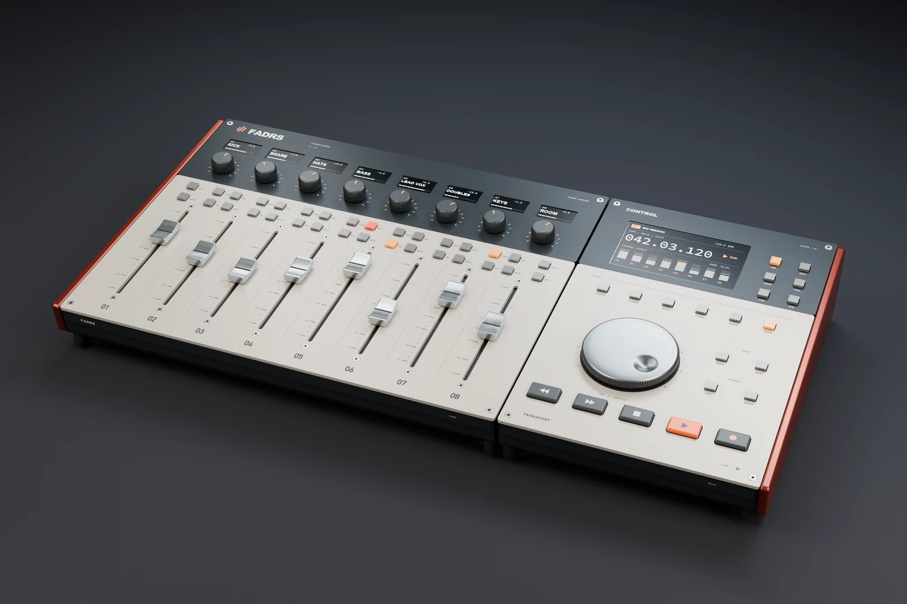

# FADRS Studio Eight

An eight-channel motorized control surface concept for mixing music. Each track gets a 100 mm fader, an encoder, a small display and four dedicated keys. A separate transport module keeps the jog wheel and playback controls in the same place as the mix moves between banks.

**Project stage · digital hardware prototype.** The design includes an editable Blender assembly, an eight-piece STEP enclosure and a routed KiCad board for one fader. The screens show an example session. Full-system electronics, firmware and physical testing are still open.

## Explore the project

| Start here | What you’ll find |
| --- | --- |
| [Portfolio case study](docs/portfolio.md) | The design brief, one mechanical problem and its resolution, ready-to-use copy, image captions and credits |
| [Design and component reference](FADRS-Studio/README.md) | Physical layout, part numbers, model sources, carrier wiring and instructions for opening and rendering the source files |
| [Verification record](docs/verification.md) | Dimensions, clearance calculations, KiCad reports, enclosure checks and the remaining bench work |
| Full-resolution renders | [Full assembly](FADRS-Studio/FADRS-Hero.png) · [Panel layout](FADRS-Studio/FADRS-Panel.png) · [Fader detail](FADRS-Studio/FADRS-Faders.png) · [Transport detail](FADRS-Studio/FADRS-Transport.png) |

## Open the source

- **Blender 5** · open the [studio scene](FADRS-Studio/FADRS-Studio.blend). The hero camera is active. Use the [render script](FADRS-Studio/render.py) for the other three shots.
- **Mechanical CAD** · import the [STEP assembly](FADRS-Studio/FADRS-Enclosure.step) in millimetres to inspect the two trays, four faceplates and two outer cheeks.
- **KiCad 9** · open the [fader carrier project](FADRS-Studio/Fader-Carrier/Fader-Carrier.kicad_pro). Its symbol and footprint libraries are included alongside the schematic and PCB.

FADRS stands for *Fader Array DAW Remote Surface*. Project concept and direction by James Colasacco. The redesign used AI assistance for CAD, PCB layout, visualization and documentation. [Project license](LICENSE) · [Component sources and credits](FADRS-Studio/README.md#component-provenance)
